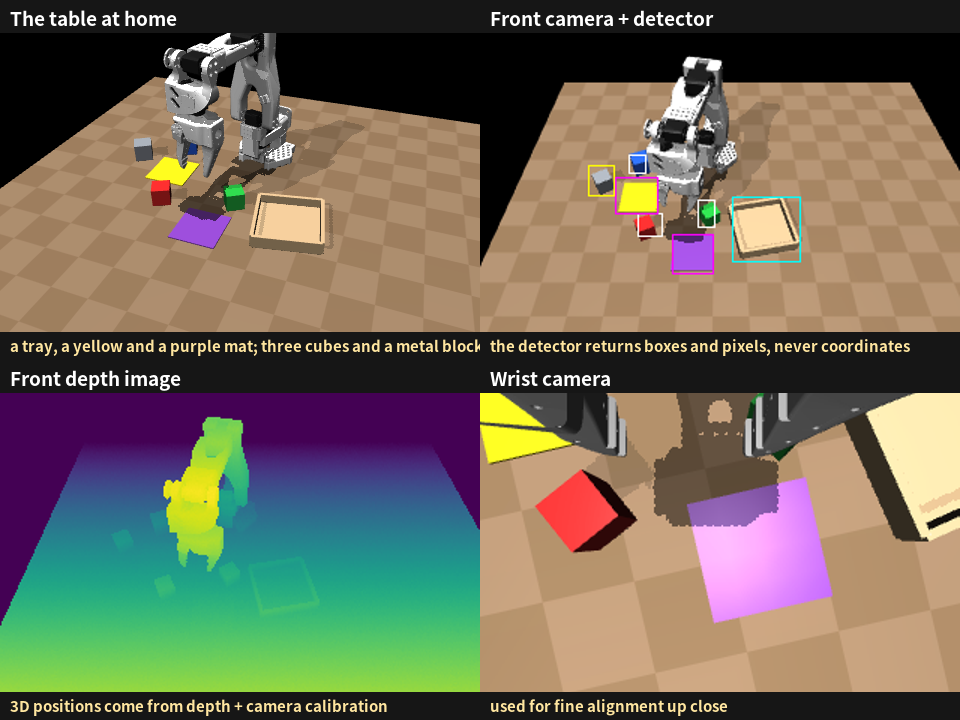

# The Aging Arm

**Can a language-model agent notice its robot body wearing out, and cope?**

**Read the report:** https://haochen2115.github.io/aging-arm/ ([English](https://haochen2115.github.io/aging-arm/en/) · [中文](https://haochen2115.github.io/aging-arm/zh/))

A language-model agent ran a small SO-101 robot arm at home for ten simulated days, doing four chores a day. Every few days its body changed without notice: a shoulder joint slipped, a motor wore out, the camera was knocked, a repair reversed a motor, and the gripper weakened. The robot could only use sensing that a real arm has: an RGB-D camera, a wrist camera, an object detector, and servo position, load and temperature. No weights were trained.

Main results:

- Left alone, the robot's factory skills went from 58% of chores on day 1 to 0% from day 8.
- Claude Opus 5.5 kept the robot at 64% over ten days, close to an oracle handed the true body model every morning (67%). Claude Haiku 5.5 reached 27%, the same as doing nothing.
- Opus built itself a morning check-up that caught a slipped joint and a reversed motor on the day they happened, with no false alarms. When a motor wore out, it changed how it worked rather than only recalibrating.
- Changes outside the agent's own checks, such as a weakened gripper, went unnoticed.

This repository hosts the report only; the experiment code is not released.

## 简介

**大模型 agent 能察觉自己的身体在老化，并想办法应对吗？**

**阅读报告：** https://haochen2115.github.io/aging-arm/zh/

一个大模型 agent 在家里操控一台 SO-101 机械臂，连续十天（仿真），每天做 4 件家务。每隔几天，它的身体就悄悄变一次：关节打滑、电机磨损、相机被碰歪、维修装反电机、夹爪变弱。它只能用真机也有的感知，不训练任何参数。Claude Opus 5.5 把十天的家务完成率保持在 64%，接近每天直接拿到真实身体模型的对照组（67%）；Claude Haiku 5.5 是 27%，和完全不维护一样。

本仓库只包含报告页面，实验代码未公开。

---

Hao Chen · haochen2115@gmail.com
